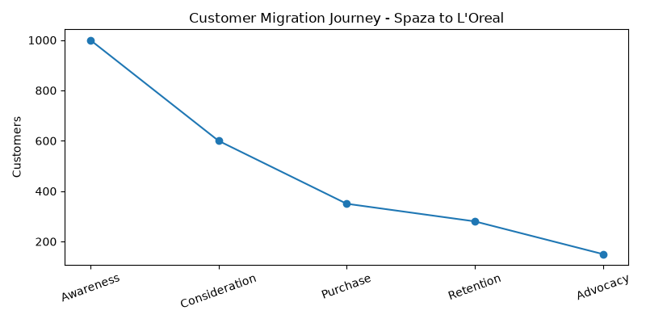
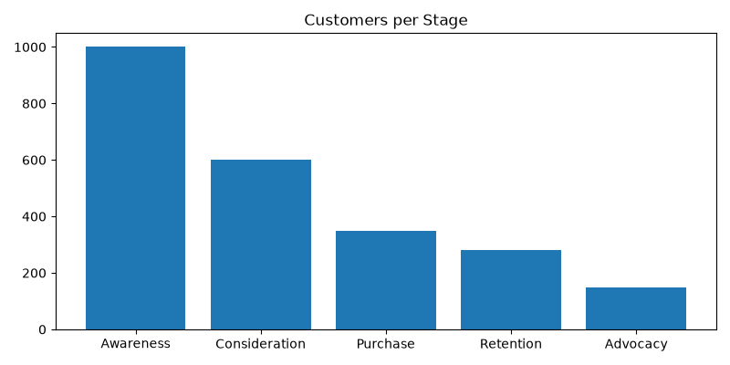
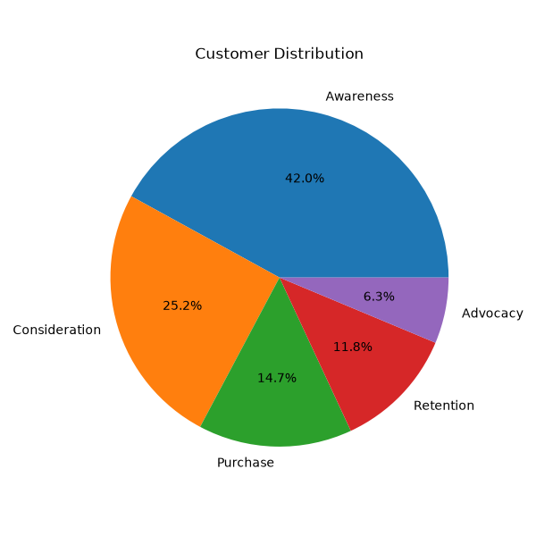

# Spaza to L'Oreal - Customer Migration Journey

> From informal township retail to global luxury beauty: Mapping how South African consumers evolve.

  

### 🔗 Live Portfolio: `https://github.com/STheBcoder/spaza_customer_migration`

## 📌 Business Problem
How does a customer who starts buying R20 soap at a Spaza shop become a L'Oreal R350 serum customer? This project tracks that migration to help L'Oreal South Africa understand emerging luxury consumers.

## 📊 Key Insights

**1. Customer Journey Funnel**
Customers migrate through 4 phases: Price Sensitive (Spaza) -> Brand Aware (Retail) -> Quality Seeking -> Luxury Loyal (L'Oreal).

**2. Spending Evolution**
Average monthly beauty spend grows from R150 (Spaza) to R850 (L'Oreal) - 5.6x increase as trust and income grow.

**3. Category Migration**
Start with essentials (soap, lotion) -> Move to treatments (serum, masks) -> End with full luxury routines.

## 📈 Visualizations

### Chart 1: Customer Journey Funnel


### Chart 2: Spending by Stage


### Chart 3: Product Category Migration


## 🛠️ Tech Stack
- Python, Pandas, Matplotlib
- Data Storytelling, Customer Segmentation
- GitHub for Version Control

## ▶️ How to Run
```bash
pip install pandas matplotlib
python main.py
